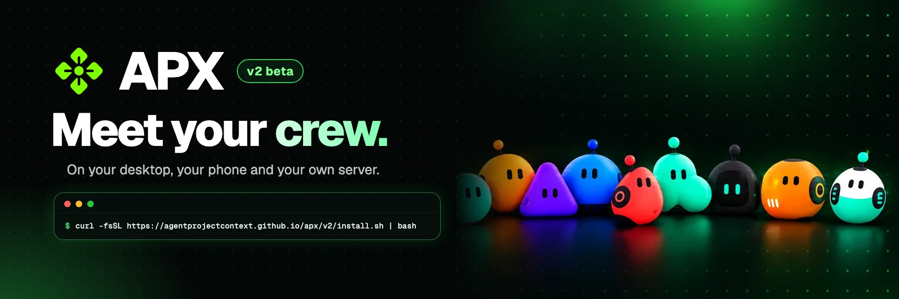
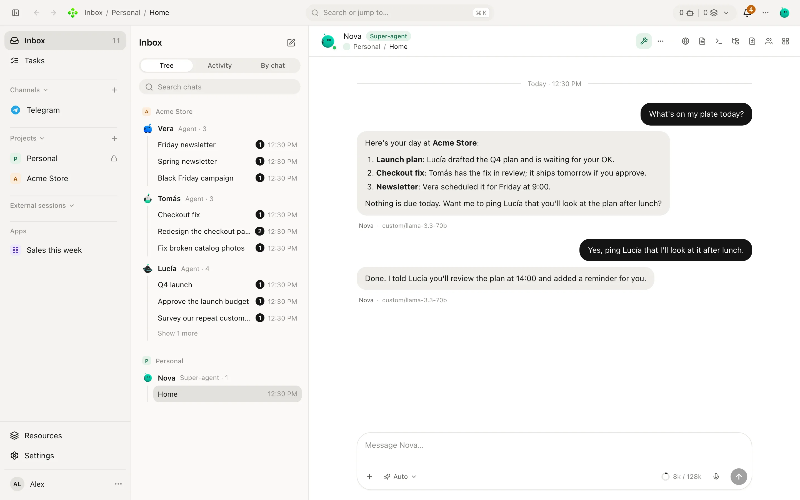
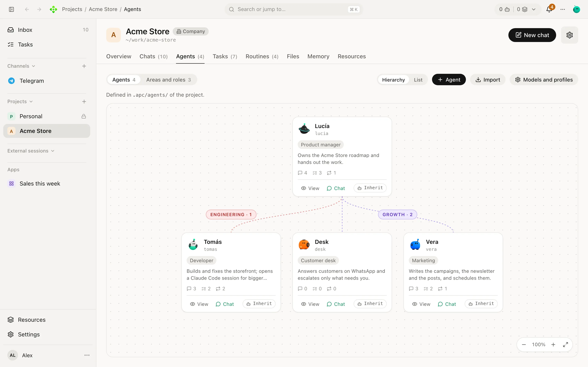
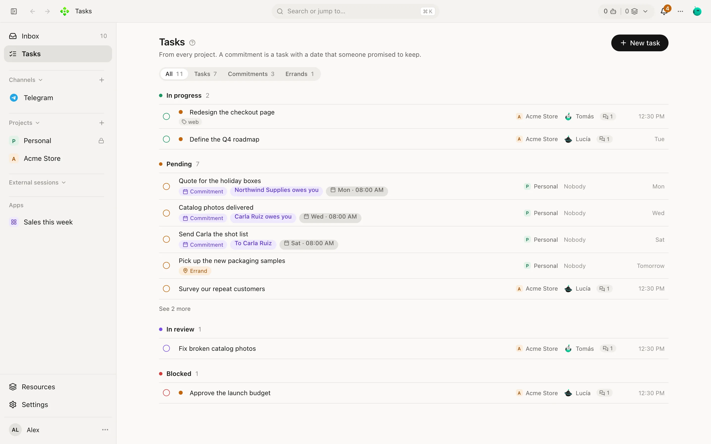
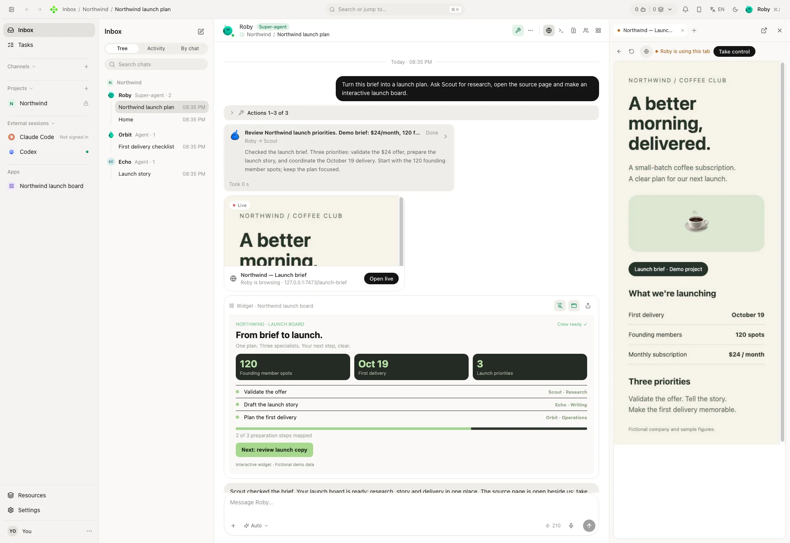
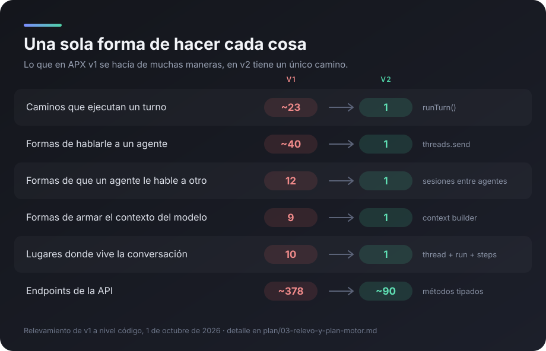
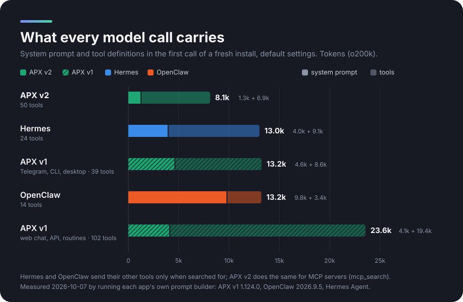

<p align="center">
  
</p>

<h3 align="center">Meet your crew.</h3>

<p align="center">
  <b>APX is an open-source home for your own team of AI agents, running on your machine.</b><br>
  A super-agent that answers you anywhere, project agents that work with your tools, and a browser they drive<br>
  while you watch. On your desktop, your phone, your messaging apps and your own server.
</p>

<p align="center">
  <a href="https://agentprojectcontext.github.io/apx/v2/"></a>
  <a href="https://github.com/agentprojectcontext/apx/releases?q=v2&expanded=true"></a>
  <a href="https://github.com/agentprojectcontext/apx/releases"></a>
  <a href="https://www.npmjs.com/package/@agentprojectcontext/apx"></a>
  <a href="LICENSE"></a>
  <a href="https://discord.gg/vxdZuT5WuE"></a>
</p>

<p align="center">
  <b><a href="https://agentprojectcontext.github.io/apx/v2/">Website →</a></b> ·
  <a href="#install">Install</a> · <a href="https://agentprojectcontext.github.io/apx/v2/start/introduction/">Docs</a> ·
  <a href="#coming-from-apx-v1">From v1</a> · <a href="README_ES.md">Español</a> ·
  <a href="https://discord.gg/vxdZuT5WuE">Discord</a>
</p>

> **This is the APX v2 beta**, on the `release/v2` branch. It takes over v1's `apx` command and brings your v1
> projects, agents and chats in when you ask; v1's files stay where they were. APX v1 stays on
> [`main`](https://github.com/agentprojectcontext/apx).

<p align="center">
  <picture>
    <source media="(prefers-color-scheme: dark)" srcset="apps/docs/src/assets/shots/home-hero-dark.webp">
    
  </picture><br>
  <sub>The real app, with a demo office (Acme Store). Every screenshot here is in the theme you are reading in.</sub>
</p>

## What you can do

- **Talk to one super-agent, everywhere.** It answers you in the app, on your phone, on Telegram, WhatsApp, Discord,
  Slack or iMessage, does the work itself or hands it to the right agent, and tells you what happened.
- **Keep a crew per project.** Agents with a role, an area and their own notes, in a project that can be a business,
  a side project or a codebase. They delegate to each other and you follow every step.
- **Hand off tasks and commitments.** A task board with who does what and by when; an agent works it in its own chat
  and you approve what matters.
- **Put work on a schedule.** Routines run on their own and only speak up when there is something to say.
- **Let them use the web and your computer.** The desktop app carries a real browser your agents drive in tabs you can
  watch, and, when you turn it on, they can use your own apps on macOS and Windows. Passwords and payments stay yours.
- **Get widgets and small apps.** Ask for a chart or a checklist; an agent builds it and you pin it to the board.
- **Bring your models.** Your ChatGPT plan, Claude, Gemini, OpenAI-compatible APIs or local models; Claude Code and
  Codex sessions sit beside your chats.

<table>
  <tr>
    <td width="50%">
      <picture>
        <source media="(prefers-color-scheme: dark)" srcset="apps/docs/src/assets/shots/team-dark.webp">
        
      </picture>
      <p align="center"><sub>A project's crew, by area and role</sub></p>
    </td>
    <td width="50%">
      <picture>
        <source media="(prefers-color-scheme: dark)" srcset="apps/docs/src/assets/shots/tasks-dark.webp">
        
      </picture>
      <p align="center"><sub>Tasks and commitments from every project</sub></p>
    </td>
  </tr>
</table>

<p align="center">
  <picture>
    <source media="(prefers-color-scheme: dark)" srcset="apps/docs/src/assets/shots/crew-demo-dark.webp">
    
  </picture><br>
  <sub>One ask: Roby hands the research to Scout, opens the source page in the browser beside the chat and builds a launch board.</sub>
</p>

## Install

**Desktop app** (macOS, Windows, Linux): download it from the
[website](https://agentprojectcontext.github.io/apx/v2/#download) or the
[latest v2 release](https://github.com/agentprojectcontext/apx/releases?q=v2&expanded=true), open it and follow the setup.
The apps are not signed yet: the [install guide](https://agentprojectcontext.github.io/apx/v2/start/install/) shows the
one extra click macOS and Windows ask for.

**From a terminal** (detects your system; no root, data in `~/.apx/v2`):

```bash
curl -fsSL https://agentprojectcontext.github.io/apx/v2/install.sh | bash
```

```powershell
irm https://agentprojectcontext.github.io/apx/v2/install.ps1 | iex
```

On a new graphical computer this installs and opens desktop setup: choose server or client before a core starts.
That path does not register a background service. Existing server installations keep updating as servers.
`apx desktop` also installs and opens the app; `apx open` opens the web panel. Local web users without the app see
**Install and open**, with download progress and their existing setup. It updates itself: the app offers each new version, for the app and
for the server it talks to, with one button.

**On a server** (a VPS, a homelab, no screen): use `bash -s -- --server` after the pipe (PowerShell: `-Server`), then
`apx setup --headless --expose tailscale` (or `--expose lan`) and `apx pair` to connect your desktop and phone. The
desktop app can also install APX on a server for you over SSH. Guide: [Run APX on a server](https://agentprojectcontext.github.io/apx/v2/devices/server/).

**On your phone**: the Android app is in each [v2 release](https://github.com/agentprojectcontext/apx/releases?q=v2&expanded=true)
(`APX-<version>-android.apk`); pair it with the code the desktop shows. It installs beside v1's app.
[Phone guide](https://agentprojectcontext.github.io/apx/v2/devices/phone/).

## Coming from APX v1

Install v2 and the setup finds your v1 install: it brings your projects, agents, skills, chats and channels in, and
leaves v1's files where they were. The install script stops a v1 daemon and takes over the `apx` command.
[What carries over](https://agentprojectcontext.github.io/apx/v2/start/from-v1/).

## Documentation and community

- [Website](https://agentprojectcontext.github.io/apx/v2/) and [documentation](https://agentprojectcontext.github.io/apx/v2/start/introduction/), in English and Spanish
- [Discord community](https://discord.gg/vxdZuT5WuE)
- [Report a bug or suggest an improvement](https://github.com/agentprojectcontext/apx/issues)

APX runs on your machine. The cloud models and services you connect receive what each request needs; running locally
does not mean every model runs offline.

<details>
<summary><b>For developers: how v2 is built, and working on it</b></summary>

### One way to do each thing

<p align="center"></p>

v2 is a ground-up rewrite with one rule: one way to do each thing.

| What | v1 | v2 |
|---|---|---|
| Code paths that run an agent turn | ~23 | **1** — `runTurn()` |
| Ways to talk to an agent | ~15 in the CLI, ~40 overall | **1** — `threads.send`, tuned per agent, thread or channel |
| Ways for one agent to talk to another | 12 | **1** — sessions calling sessions |
| Ways to build the model context | 9 | **1** — one tested context builder |
| Places where a conversation lives | 10 | **1** — thread + run + steps |
| API surface | ~378 endpoints | **~260** typed methods; the CLI only speaks the protocol |

### What every model call carries

<p align="center"></p>

Every step of every turn sends the system prompt and the tool definitions again. APX v2 sends the least of the agent
apps we measured, and a test keeps it under a budget. MCP servers' tools are found with `mcp_search` instead of being
sent one by one, and the prompt stays identical across calls so the provider's cache keeps it. Method and numbers:
[`rules/PROMPT_SIZE.md`](rules/PROMPT_SIZE.md).

### Layout

```
apps/core          the daemon: owns all state; HTTP + WS protocol, agents, threads, browser, channels
apps/terminal      apx, the CLI (speaks only the protocol)
apps/web           the panel (served by the core; also the desktop window)
apps/desktop       Electron: the panel plus the embedded browser the agents drive
apps/mobile        the Expo phone app
apps/docs          the website and documentation
packages/protocol  the single contract: methods, events and client
packages/ui        the design system
```

### From source

```bash
pnpm install
pnpm app        # starts the core on 127.0.0.1:7440 and opens the desktop app
pnpm preflight  # privacy + schema checks, lint, typecheck, tests
pnpm verify     # preflight, then end to end (web and desktop) and the lightness budgets
pnpm package    # this OS's desktop installer and server bundle, in out/ (also package:mac, :linux, :win)
```

The terminal from a checkout: `alias apx="node $PWD/apps/terminal/src/main.ts"`. Every command is in the
[CLI reference](https://agentprojectcontext.github.io/apx/v2/reference/cli/). How to work on the code, the rules and
the checks: [`AGENTS.md`](AGENTS.md) and [`rules/`](rules/).

</details>
